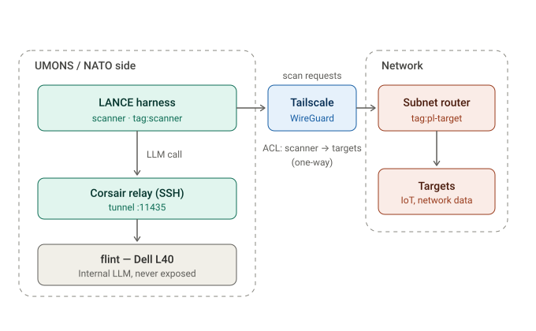

# Partner access (Polish site) over Tailscale

The partner (Polish) site must be able to run **our harness** against **their**
target network, without either side exposing its own infrastructure. The mini PC
`nato-master-1` runs the harness and reaches the partner subnet through an
encrypted Tailscale bridge. The `flint` LLM stays internal (Corsair SSH relay to
the Dell L40) and is never exposed to the partner. An ACL allows a single
direction: scanner → targets.



## How it works

- **Scan origin.** The harness runs on `nato-master-1` (`tag:scanner`). It is the
  node that emits scan packets, so it is the node that needs the partner route.
- **Bridge.** Tailscale (WireGuard) connects only the mini PC to the partner's
  subnet router — not the whole tailnet.
- **LLM stays internal.** `flint` is reached through the Corsair relay
  (`:11435` → Dell L40). The partner never touches it.
- **One-way ACL.** The scanner may reach the partner subnet; nothing on the
  partner side may reach back into our network.

## What each side configures

| Where | What | Who |
| --- | --- | --- |
| Mini PC `nato-master-1` | `sudo tailscale set --accept-routes` | us |
| Partner subnet | subnet router (`--advertise-routes=<SUBNET>`) | partner |
| Tailnet admin | ACL: `tag:scanner` → partner subnet only | us |
| Governance | dedicated tailnet **or** node-share of the mini PC only | us |
| Paper | written audit perimeter (Rules of Engagement) | both |

## What the partner must provide

- The **subnet CIDR** they expose (e.g. `10.20.0.0/24`).
- The **target IPs and ports** for the end-to-end connectivity test.

## Commands

On a machine **inside the partner target network** (partner runs this):

```bash
sudo tailscale up --advertise-routes=<SUBNET> --hostname=pl-target-router
```

On the mini PC `nato-master-1` (we run this):

```bash
sudo tailscale set --accept-routes
ip route | grep -E 'tailscale|<SUBNET>'   # confirm the route is up
```

Tailnet admin ACL (Tailscale console, Access Controls) — the scanner reaches only
the partner subnet, and the partner reaches nothing of ours:

```json
{
  "tagOwners": {
    "tag:scanner":   ["autogroup:admin"],
    "tag:pl-target": ["autogroup:admin"]
  },
  "autoApprovers": {
    "routes": { "<SUBNET>": ["tag:pl-target"] }
  },
  "acls": [
    { "action": "accept", "src": ["tag:scanner"], "dst": ["<SUBNET>:*"] }
  ]
}
```

> If the policy still contains the default `{"action":"accept","src":["*"],"dst":["*:*"]}`
> rule, remove it — otherwise it opens everything and cancels the isolation.

End-to-end test from `nato-master-1` (replace with a real target IP and port):

```bash
nc -zv <TARGET_IP> <PORT>
```
