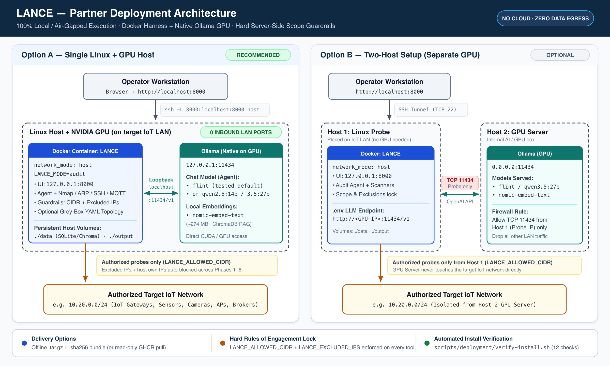

# LANCE — partner deployment guide

LANCE is an LLM-driven IoT security-audit tool. In this deployment **you run it on
your own host, on your own network**. Nothing leaves your network: the LLM runs on
your Ollama, embeddings run locally, and there is no call back to UMONS. We ship
you a self-contained container image; you run it on one Linux GPU host.

## 1. What you provide

| Item | Requirement |
| --- | --- |
| Host | One **Linux** machine with a **GPU**, placed on the network segment to audit |
| Runtime | **Docker** + the Docker Compose plugin |
| LLM | **Ollama** on that host (GPU), with the models below pulled |
| CPU/RAM | Modest for the harness itself; the GPU is for the LLM |
| Internet | **Not required** — the deployment runs fully offline |

The harness and the LLM can share the one GPU host (simplest), as long as it sits
on the target segment. Host networking is used so the scanner can reach the
targets directly.

## 2. Install Ollama and pull the models

Install Ollama on the Linux GPU host (`curl -fsSL https://ollama.com/install.sh | sh`
when online, or via the official Linux tarball for air-gapped hosts) and verify
the GPU is detected (`nvidia-smi` and `ollama --version`).

LANCE needs two models on Ollama — a tool-capable chat model for the agent, and
the embedding model for the local knowledge store:

```bash
ollama pull qwen2.5:14b          # ~10 GB VRAM (or qwen3.5:27b on >=24 GB VRAM)
ollama pull nomic-embed-text     # embeddings — required, runs locally (~274 MB)
```

Use any tool-capable model Ollama serves; note the exact tag — you set it in
`.env` below.

**Air-gapped host (no internet at setup time):** pull both models once on a
staging Linux machine with Ollama, then copy Ollama's model store to the target
host and restart Ollama:

```bash
# On the staging machine (after `ollama pull`):
tar czf ollama-models.tar.gz -C /usr/share/ollama/.ollama models

# On the air-gapped host:
sudo systemctl stop ollama
sudo tar xzf ollama-models.tar.gz -C /usr/share/ollama/.ollama
sudo chown -R ollama:ollama /usr/share/ollama/.ollama/models
sudo systemctl start ollama
ollama list                      # verify both tags appear
```

## 3. Load the image (offline)

We deliver a tarball (`lance-<tag>-amd64.tar.gz`) and its `.sha256`:

```bash
sha256sum -c lance-<tag>-amd64.tar.gz.sha256     # verify integrity
gunzip -c lance-<tag>-amd64.tar.gz | docker load # restores ghcr.io/tanguyvans/lance:latest
```

No registry access is needed. The image is `amd64`.

## 4. Configure `.env`

Copy the template and edit the few lines that matter:

```bash
cp .env.example .env
```

```ini
# Application mode: pure physical-network audit harness (English UI & reports, no UMONS lab UI)
LANCE_MODE=audit

# Hard Rules of Engagement perimeter enforced server-side (HTTP 403 outside scope)
LANCE_ALLOWED_CIDR=10.20.0.0/24
LANCE_EXCLUDED_IPS=10.20.0.1,10.20.0.10

# Local admin password you invent yourself (e.g. `openssl rand -hex 24`)
LANCE_ADMIN_TOKEN=<random-32+-chars>

# Dashboard stays on localhost; reach it over an SSH tunnel (see §6). Do not put
# it on the LAN: the scan-launch endpoint is unauthenticated.
LANCE_BIND_HOST=127.0.0.1

# Your Ollama endpoint + served chat model (reconciled into LANCE at every boot)
AGENT_PROVIDER=ollama
LANCE_LLM_BASE_URL=http://localhost:11434/v1
LANCE_LLM_MODEL=qwen2.5:14b
# LANCE_API_TIMEOUT_S=300

# Embeddings run locally on your Ollama — no cloud
LANCE_EMBEDDINGS=ollama
LANCE_EMBED_MODEL=nomic-embed-text
```

`LANCE_LLM_MODEL` must match a tag you pulled in §2, or the agent gets a 404.
*(Legacy `LANCE_MOE_BASE_URL` / `LANCE_MOE_MODEL` and `AGENT_PROVIDER=ollama-umons` remain supported.)*

## 5. Start

```bash
docker compose up -d
docker compose logs -f        # first boot ingests the knowledge store locally
scripts/deployment/verify-install.sh   # optional automated health + offline check
```

The compose file defaults to `network_mode: host` (Linux) so the scanner can emit
SYN scans and reach Ollama at `localhost:11434`.

## 6. Network topology, ports, and reaching the dashboard



*(Editable vector source: [`assets/lance-deployment-architecture.svg`](assets/lance-deployment-architecture.svg).)*

### Ports to open (or keep closed)

| Topology | LANCE host | Ollama (GPU) host | Inbound ports to open on LAN |
| --- | --- | --- | --- |
| **Single-host (recommended)** | Linux + GPU on target segment (`network_mode: host`) | Same host (`127.0.0.1:11434`) | **None.** Both Ollama (`11434`) and LANCE (`8000`) stay on `127.0.0.1`. Only outbound audit probes go to the authorized CIDR. |
| **Two-host** (separate GPU box) | Linux probe on target segment (`network_mode: host`) | Separate GPU server (`OLLAMA_HOST=0.0.0.0:11434`) | **TCP `11434` on the GPU server only**, firewalled to allow **only the LANCE probe's IP**. Set `LANCE_LLM_BASE_URL` (and `LANCE_EMBED_BASE_URL` if different) to `http://<gpu-ip>:11434/v1`. |
| **Bridge fallback** (non-Linux / no SYN scan) | Docker bridge (`ports: 127.0.0.1:8000:8000`) | Host (`host.docker.internal:11434`) | **None on LAN** if published on `127.0.0.1:8000`. Requires `LANCE_BIND_HOST=0.0.0.0` in `.env` and `LANCE_LLM_BASE_URL=http://host.docker.internal:11434/v1`. |

In two-host mode, enable remote listening on the GPU host via a systemd drop-in
(`sudo systemctl edit ollama`), add `[Service]` / `Environment="OLLAMA_HOST=0.0.0.0:11434"`,
restart Ollama, and restrict port `11434` with `ufw`/`nftables` to the LANCE host IP.

### Reach the dashboard

The dashboard is bound to `127.0.0.1:8000` on the LANCE host. From your workstation,
tunnel in over SSH (port `22` only):

```bash
ssh -L 8000:localhost:8000 <user>@<host>
# then open http://localhost:8000
```

## 7. Scope, exclusions, grey-box topology, and Rules of Engagement

- Every audit is launched with an **authorized target CIDR** (or single IPv4 host,
  auto-normalized to `/32`). LANCE **enforces this at tool-execution time**: every
  scan/exploit tool is confined to that CIDR and refuses any target outside it
  (fail-closed).
- **Hard admin perimeter (recommended):** set `LANCE_ALLOWED_CIDR` and
  `LANCE_EXCLUDED_IPS` in `.env` to lock the ceiling server-side. Excluded hosts
  (e.g. your core router, hypervisor, and the LANCE host itself — which is also
  auto-excluded via its local interface IPs) are stripped from `arp_scan`, passed to
  `nmap --exclude`, and rejected by all verification/intrusion tools across all 6 phases.
- **Black-box or grey-box:** you can run pure black-box discovery on a CIDR, or
  expand **Scope exclusions & network structure (optional)** in the dashboard to
  import/paste a base YAML/JSON topology (devices, links, extra exclusions). Declared
  devices are treated as an open hypothesis — active recon verifies them and still
  discovers undocumented ("shadow") hosts on the subnet.
- **Scope selector:** choose **Analysis only (1–3)** for non-intrusive discovery &
  vulnerability analysis, or **Full audit (1–6)** to add active proof verification,
  intrusion assessment, and the final report.
- Before any run, both sides agree in writing on the **perimeter** (subnet/hosts,
  exclusions) and **time window** (signed Rules of Engagement).
- Keep the dashboard off the LAN (§6). Scan launch is unauthenticated by default,
  so the localhost bind is the primary control. For extra app-layer hardening set
  `LANCE_REQUIRE_LAUNCH_AUTH=1` — launches then require a Bearer admin token.

## 8. What we deliver to you

- The image bundle (`lance-<tag>-amd64.tar.gz` + `.sha256`).
- `docker-compose.yml`, `.env.example`, and `scripts/deployment/verify-install.sh` (in the repository).
- This guide and the step-by-step [installation & test guidelines](install-smoke-test.md).

You provide the host, the GPU/Ollama with the models, and the signed RoE.
